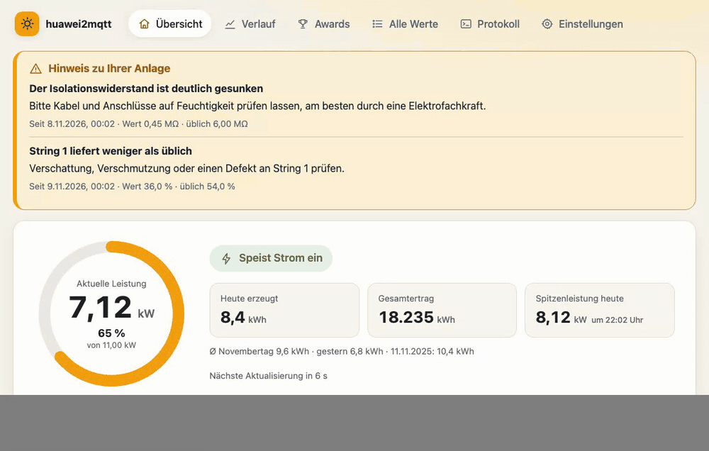
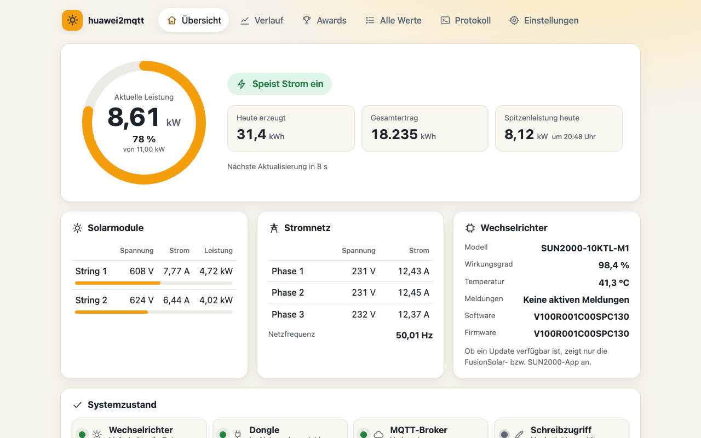
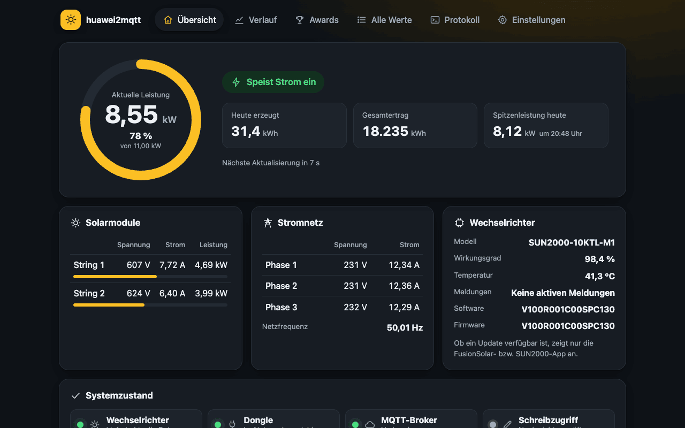
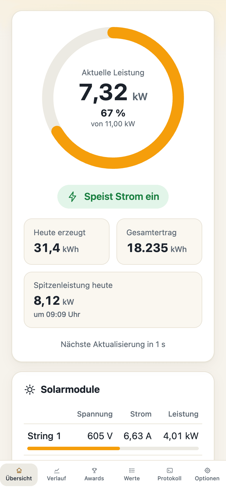
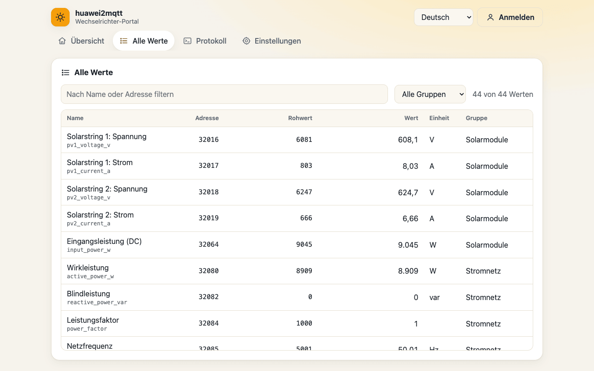
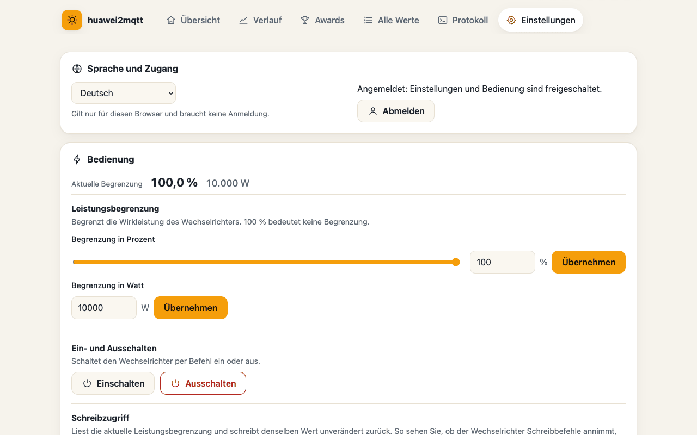
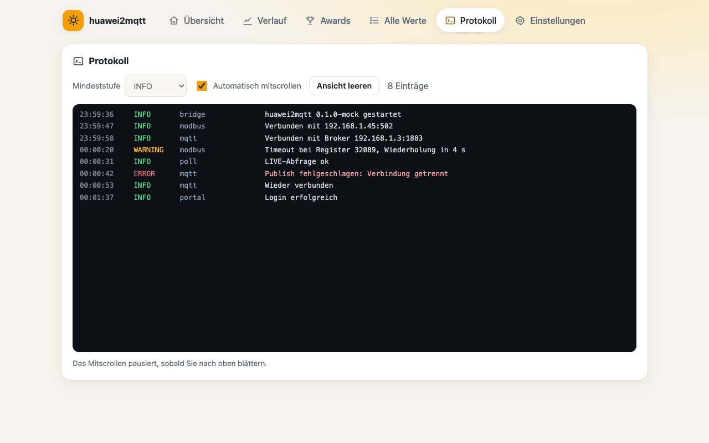
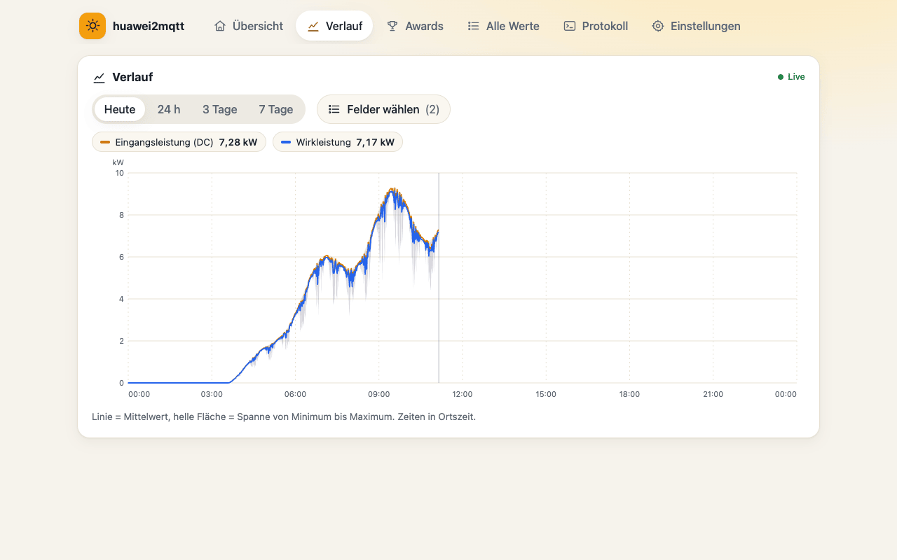
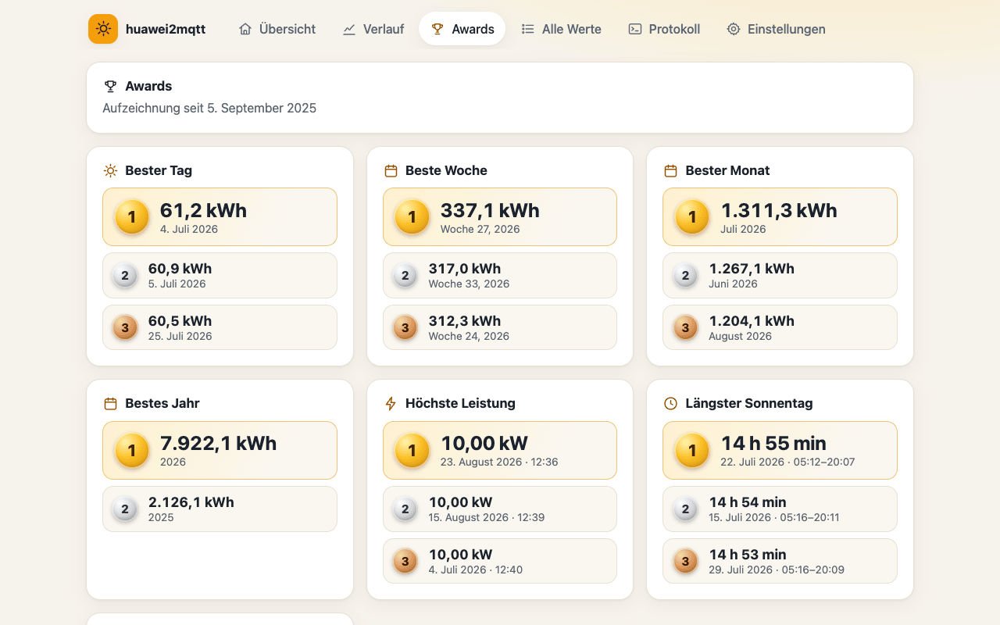
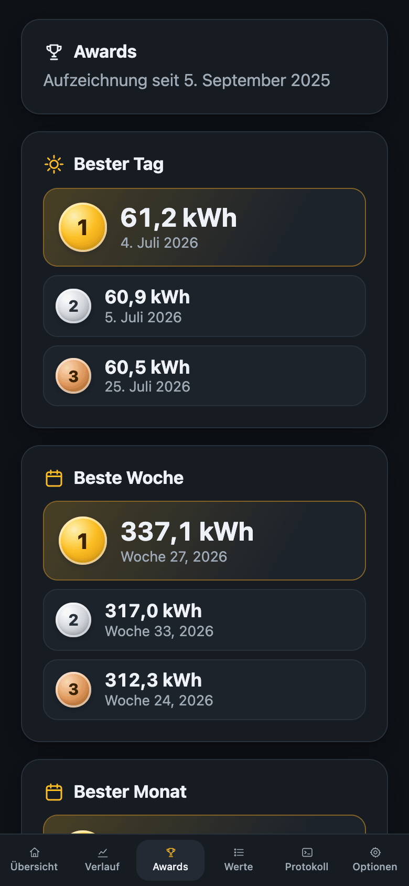

# huawei2mqtt

**Bringt deinen Huawei-SUN2000-Wechselrichter ins MQTT – alle Werte lesen, das Wichtigste steuern, alles in einem freundlichen Web-Portal sehen.**

[🇬🇧 English version](README.md)



huawei2mqtt ist ein kleiner Docker-Container, der per **Modbus TCP** (meist über den
Huawei-**SDongle**) mit einem Huawei-SUN2000-Wechselrichter spricht, alle Live-Werte an
deinen **MQTT-Broker** sendet und einige sorgfältig ausgewählte **Befehle** annimmt
(Leistungsbegrenzung, Ein/Aus). Ein eingebautes Web-Portal zeigt den aktuellen Zustand,
alle Registerwerte, den Verbindungsstatus jeder Komponente und das Protokoll – in
sieben Sprachen.

- 📈 **Alle Daten**: PV-Strings, Netz (3 Phasen), Ertrag, Zustand in Klartext, Temperatur, Isolation, Alarme, Gerätedaten
- 🎛️ **Steuerung**: Wirkleistung in % oder W begrenzen, Wechselrichter einschalten – und ausschalten, wenn du es ausdrücklich erlaubst
- 📊 **Verlauf & Awards**: jeder 10-Sekunden-Wert für 7 Tage (einstellbar) im Live-Diagramm; bester Tag/Woche/Monat/Jahr, Spitzenleistung, Meilensteine, eingespartes CO₂ und Ertrag in Euro – alles lokal in SQLite gespeichert und auch per MQTT abfragbar
- 🛡️ **Robust**: übersteht Ausfälle von Wechselrichter, Dongle oder Broker, verbindet sich selbst neu und überlastet den Dongle nie
- 🪶 **Schlank**: ein kleiner Python-Prozess, rund 4 Laufzeit-Bibliotheken, ca. 30 MB RAM, ohne Root-Rechte
- 🍓 **Läuft auf dem Raspberry Pi**: Images für amd64 und arm64 (Raspberry Pi 3/4/5 mit 64-Bit-System)
- 🌍 **Portal in 7 Sprachen**: Deutsch, English, Nederlands, Français, Italiano, Español, Polski
- ⚙️ **Konfiguration über eine einzige `.env`-Datei**

> Getestet mit einem **SUN2000-10KTL-M1** hinter einem **SDongleA**. Andere SUN2000-Modelle
> (KTL-M0/M1/M2, MAP0, L1 …) nutzen dieselbe Modbus-Registerbelegung und sollten für die
> hier abgedeckten Werte funktionieren. Batteriespeicher (LUNA2000) und Smart Meter
> (DTSU666) werden noch nicht unterstützt – Beiträge willkommen, siehe [Erweitern](#erweitern).

---

## Inhalt
- [Screenshots](#screenshots)
- [Voraussetzungen](#voraussetzungen)
- [Schnellstart](#schnellstart)
- [Konfiguration](#konfiguration)
- [MQTT-Topics](#mqtt-topics)
- [Befehle](#befehle)
- [Web-Portal](#web-portal)
- [Betrieb hinter einem Reverse Proxy](#betrieb-hinter-einem-reverse-proxy)
- [Fehlersuche](#fehlersuche)
- [Erweitern](#erweitern)
- [Entwicklung](#entwicklung)
- [Credits & Lizenz](#credits--lizenz)

## Screenshots

| Übersicht (hell) | Übersicht (dunkel) | Mobil |
|---|---|---|
|  |  |  |

| Alle Werte | Einstellungen & Bedienung | Protokoll |
|---|---|---|
|  |  |  |

| Verlauf | Awards | Awards (Handy, dunkel) |
|---|---|---|
|  |  |  |

## Voraussetzungen

1. **Modbus TCP muss am SDongle freigeschaltet sein.** In der FusionSolar-App:
   *Inbetriebnahme* → als **Installateur** anmelden → *Einstellungen* →
   *Kommunikationskonfiguration* → *Dongle-Parametereinstellungen* → **Modbus TCP** →
   **Aktivieren (uneingeschränkt)**. „Eingeschränkt“ erlaubt nur freigegebenen
   Clients das Lesen; für Befehle braucht es *uneingeschränkt*. Mit dem normalen
   *Eigentümer*-Konto ist die Option nicht sichtbar – deshalb finden sie viele nicht.
2. Der SDongle (oder der WLAN/FE-Anschluss des Wechselrichters) muss vom Docker-Host aus
   über TCP-Port **502** erreichbar sein.
3. Ein **externer MQTT-Broker** (z. B. Mosquitto). huawei2mqtt bringt keinen Broker mit.
4. Docker mit Compose.

> ℹ️ Der SDongle bedient zuverlässig **nur einen Modbus-TCP-Client gleichzeitig**. Lass
> keine weiteren Modbus-Werkzeuge parallel darauf zugreifen. Die FusionSolar-Cloud
> funktioniert neben huawei2mqtt ganz normal weiter.

## Schnellstart

```bash
mkdir huawei2mqtt && cd huawei2mqtt
curl -LO https://raw.githubusercontent.com/Rilnaista/huawei2mqtt/main/docker-compose.yml
curl -L  https://raw.githubusercontent.com/Rilnaista/huawei2mqtt/main/.env.example -o .env
# .env bearbeiten: mindestens HUAWEI_HOST und MQTT_HOST (+ Zugangsdaten, PORTAL_PASSWORD)
docker compose up -d
```

Dann `http://<docker-host>:8080` öffnen. Nach wenigen Sekunden erscheinen die Werte;
auf dem Broker findest du sie unter `huawei/<Seriennummer>/…`:

```bash
mosquitto_sub -h <broker> -u <benutzer> -P <kennwort> -t 'huawei/#' -v
```

Images: `ghcr.io/rilnaista/huawei2mqtt` (Tags `latest`, `x.y.z`, `x.y`) für linux/amd64 und linux/arm64 –
das arm64-Image läuft auf dem Raspberry Pi 3/4/5 mit 64-Bit-System (Standard beim aktuellen Raspberry Pi OS).
Das 32-Bit-Raspberry-Pi-OS (armv7) wird noch nicht unterstützt.

## Konfiguration

Alles wird in der `.env` eingestellt ([`.env.example`](.env.example) enthält alle
Schlüssel mit Kommentar). Pflicht sind nur `HUAWEI_HOST` und `MQTT_HOST`.

| Schlüssel | Standard | Bedeutung |
|---|---|---|
| `HUAWEI_HOST` | – | IP/Hostname des SDongles (oder Wechselrichters) **(Pflicht)** |
| `HUAWEI_PORT` | `502` | Modbus-TCP-Port |
| `HUAWEI_UNIT_ID` | `1` | Modbus-Geräteadresse des Wechselrichters (hinter SDongle meist `1`, direkt per WLAN-FE oft `0`) |
| `HUAWEI_DEVICE_ID` | Seriennummer | Name im Topic statt der Seriennummer |
| `HUAWEI_ALLOW_SHUTDOWN` | `false` | Befehl `off` erlauben. Aus Sicherheitsgründen standardmäßig aus |
| `MODBUS_TIMEOUT` | `5` | Zeitlimit je Anfrage (s) |
| `MODBUS_REQUEST_DELAY_MS` | `200` | Pause zwischen zwei Anfragen (schont den Dongle) |
| `POLL_INTERVAL_LIVE` | `10` | Intervall Live-Werte (s), mindestens 5 |
| `POLL_INTERVAL_STATIC` | `300` | Intervall Gerätedaten/Steuerwerte (s), mindestens 60 |
| `MQTT_HOST` | – | Broker-Host **(Pflicht)** |
| `MQTT_PORT` | `1883` | Broker-Port |
| `MQTT_USERNAME` / `MQTT_PASSWORD` | – | Broker-Zugangsdaten (optional) |
| `MQTT_CLIENT_ID` | `huawei2mqtt-<id>` | MQTT-Client-ID |
| `MQTT_TLS` / `MQTT_TLS_INSECURE` / `MQTT_CA_FILE` | `false` / `false` / – | TLS zum Broker |
| `MQTT_KEEPALIVE` | `60` | Keepalive (s) |
| `MQTT_QOS` | `0` | QoS der veröffentlichten Werte |
| `MQTT_RETAIN` | `true` | Werte mit Retain-Flag senden |
| `MQTT_BASE_TOPIC` | `huawei` | Topic-Präfix |
| `MQTT_FLAT_TOPICS` | `true` | Zusätzlich ein Topic je Einzelwert |
| `PORTAL_PORT` | `8080` | Host-Port des Portals (Compose-Mapping) |
| `PORTAL_PASSWORD` | – | Kennwort für Änderungen im Portal. Leer = Portal nur lesbar |
| `HISTORY_DAYS` | `7` | Wie viele Tage der 10-Sekunden-Verlauf aufbewahrt wird (1–90). Tageswerte/Awards bleiben dauerhaft |
| `FEED_IN_TARIFF` | `0.08` | Einspeisevergütung pro kWh für den Award „Ertrag in Geld“ |
| `CURRENCY` | `EUR` | Währungskürzel für Geldbeträge |
| `CO2_FACTOR` | `0.38` | Eingespartes CO₂ in kg pro kWh (Standard ≈ deutscher Strommix) |
| `MILESTONE_STEP_KWH` | `1000` | Abstand der Meilensteine beim Gesamtertrag |
| `LOG_LEVEL` | `INFO` | `DEBUG`, `INFO`, `WARNING`, `ERROR` |
| `TZ` | `Europe/Berlin` | Zeitzone |

Intervalle, Log-Stufe, Retain, Einzel-Topics, Verlaufstage, Vergütung, Währung, CO₂-Faktor und Meilenstein-Abstand lassen sich nach dem Login auch im
Portal ändern; diese Änderungen liegen im Volume `/data` und haben Vorrang vor der
`.env`. Verbindungsdaten und Kennwörter ändert man nur in der `.env` – das Portal
zeigt Kennwörter nur als „gesetzt / nicht gesetzt“.

## MQTT-Topics

Basis-Topic: `<MQTT_BASE_TOPIC>/<DEVICE_ID>`, standardmäßig **`huawei/<Seriennummer>`**.

Jede Gruppe wird als **JSON-Objekt** (mit Zeitstempel `ts` in UTC) veröffentlicht und –
sofern nicht `MQTT_FLAT_TOPICS=false` – jedes Feld zusätzlich als **eigenes Topic** mit
reinem Wert, z. B. `huawei/HV2260000000/grid/active_power_w` → `6430`.
Ungültige Werte (z. B. Isolationswiderstand nachts) sind im JSON `null` und werden
nicht als Einzel-Topic gesendet. Alle Werte sind standardmäßig „retained“.

| Topic | Intervall | Felder |
|---|---|---|
| `…/availability` | LWT | `online` / `offline` (Bridge läuft und ist verbunden) |
| `…/bridge` | bei Änderung | `inverter` (`online`/`stale`/`offline`), `dongle` (`reachable`/`unreachable`), `write_access` (`verified`/`unverified`/`denied`), `last_success`, `version`, `dropouts_24h` (kurze Kommunikations-Aussetzer in den letzten 24 h) |
| `…/pv` | live | `pv1_voltage_v`, `pv1_current_a`, `pv1_power_w`, `pv2_voltage_v`, `pv2_current_a`, `pv2_power_w`, `input_power_w` |
| `…/grid` | live | `active_power_w`, `reactive_power_var`, `power_factor`, `frequency_hz`, `voltage_l1_l2_v`, `voltage_l2_l3_v`, `voltage_l3_l1_v`, `voltage_l1_v`, `voltage_l2_v`, `voltage_l3_v`, `current_l1_a`, `current_l2_a`, `current_l3_a` |
| `…/energy` | live | `daily_yield_kwh`, `total_yield_kwh`, `peak_power_today_w`, `peak_power_today_ts` (Uhrzeit der heutigen Spitze, `null`, wenn die Bridge da nicht lief) |
| `…/inverter` | live | `status` (Text-Schlüssel, z. B. `on_grid`, `standby_no_irradiation`), `status_code`, `running`, `efficiency_pct`, `internal_temperature_c`, `insulation_resistance_mohm`, `fault_code`, `alarms` (Liste von Text-Schlüsseln), `alarm_1..3`, `state_1..3` (rohe Bitfelder), `startup_time`, `shutdown_time` |
| `…/device` | statisch | `model`, `serial_number`, `part_number`, `software_version`, `firmware_version`, `model_id`, `pv_strings`, `mppt_count`, `rated_power_w`, `max_power_w` |
| `…/control` | statisch + nach jedem Befehl | `power_limit_pct`, `power_limit_w`, `shutdown_allowed` |
| `…/awards` | beim Start, nach Mitternacht, bei Änderung (höchstens je statisches Intervall) | Ranglisten (Top 3), Meilensteine, CO₂, Geld – gleiches JSON wie `GET /api/awards` |
| `…/control/result` | nach jedem Befehl | `{"command","value","status":"ok\|rejected\|error","reason","ts"}` (nicht retained) |

**Bedeutung des Status:** `inverter = stale` heißt, die letzte Abfrage ist
fehlgeschlagen, die Werte sind aber jünger als 3 × Live-Intervall; `offline` heißt
älter. Solange stale/offline, werden die Wertegruppen nicht neu gesendet – die
retained Werte bleiben stehen, ihr `ts` zeigt das Alter. Nachts meldet der
Wechselrichter `standby_no_irradiation` und 0 W – das ist normal.

Beispiel `huawei/HV2260000000/pv`:
```json
{"pv1_voltage_v": 605.6, "pv1_current_a": 6.97, "pv1_power_w": 4221,
 "pv2_voltage_v": 622.9, "pv2_current_a": 5.77, "pv2_power_w": 3594,
 "input_power_w": 7814, "ts": "2026-06-21T11:02:10Z"}
```

### Verlauf per MQTT abfragen

Eine Anfrage an `…/history/get` senden (nicht retained, höchstens eine je 2 s); die Antwort
kommt auf `…/history/result` (nicht retained). Antworten kommen immer aus der lokalen
Datenbank der Bridge – nie aus einer zusätzlichen Modbus-Abfrage.

```bash
# heutige PV- und Einspeiseleistung, 300 Punkte (Mittel/Min/Max je Punkt)
mosquitto_pub -t 'huawei/HV2260000000/history/get' -m '{"id":"1","type":"samples","fields":["input_power_w","active_power_w"],"points":300}'
# Tageswerte eines Zeitraums
mosquitto_pub -t 'huawei/HV2260000000/history/get' -m '{"id":"2","type":"daily","from":"2026-07-01","to":"2026-07-31"}'
# Awards
mosquitto_pub -t 'huawei/HV2260000000/history/get' -m '{"id":"3","type":"awards"}'
```
`samples` versteht `from`/`to` (ISO-Zeit, Standard: heute), bis zu 10 `fields` und bis zu 2000 `points`.

## Befehle

| Topic | Payload | Wirkung |
|---|---|---|
| `…/control/power_limit_pct/set` | `0` … `100` (eine Nachkommastelle) | Wirkleistung auf einen Prozentsatz der Maximalleistung begrenzen (Register 40125). `100` = keine Begrenzung |
| `…/control/power_limit_w/set` | `0` … `max_power_w` (ganzzahlig) | Wirkleistung auf einen festen Wert in W begrenzen (Register 40126) |
| `…/control/power/set` | `on` \| `off` | Einschalten (40200) / Ausschalten (40201). **`off` nur mit `HUAWEI_ALLOW_SHUTDOWN=true`** |

Jeder Befehl antwortet auf `…/control/result` und löst ein sofortiges Neu-Lesen von
`…/control` aus. Sicherheitsregeln:

- **Retained Nachrichten auf Set-Topics werden ignoriert** – ein vergessenes retained
  `off` kann den Wechselrichter nie bei jedem Neustart ausschalten.
- Höchstens ein Schreibbefehl je 2 Sekunden; Werte außerhalb des Bereichs werden abgelehnt.
- Es gibt nur die oben genannten Befehle. Netzcode, Blindleistung / cos φ,
  Einspeisebegrenzung (braucht Smart Meter), Uhrzeit, Reset und Firmware sind
  **bewusst nicht** freigegeben.
- Die FusionSolar-App/-Cloud kann dieselben Einstellungen ändern – es gilt, wer zuletzt schreibt.

```bash
mosquitto_pub -h <broker> -u <benutzer> -P <kennwort> -t 'huawei/HV2260000000/control/power_limit_pct/set' -m 50
```

## Web-Portal

- **Übersicht** – aktuelle Leistung, Ertrag, heutige Spitze mit Uhrzeit, Zustand in Klartext, Strings, Netz, Firmware, Verbindungsstatus von Wechselrichter, Dongle und Broker, Schreibzugriff und ein Countdown bis zur nächsten Aktualisierung. Kurze Aussetzer und Ausfälle werden deutlich angezeigt.
- **Verlauf** – Live-Liniendiagramm beliebiger Werte (heute, 24 h, bis zur eingestellten Zahl von Tagen), Mittelwert-Linie mit Min/Max-Band.
- **Awards** – Top 3 der Tage, Wochen, Monate, Jahre, Spitzenleistung, längster Sonnentag, frühester Start; Meilensteine, eingespartes CO₂ und Ertrag in Geld. Ohne Smart Meter gilt *Gesamtertrag × Einspeisevergütung* – selbst verbrauchter Strom ist eigentlich mehr wert.
- **Alle Werte** – jedes Register mit Adresse, Rohwert, umgerechnetem Wert und Einheit; filterbar.
- **Protokoll** – Live-Protokoll mit Filter nach Stufe.
- **Einstellungen** – Sprache (ohne Login) und Anmeldung; nach dem Login: Leistungsbegrenzung, Ein/Aus, Schreibtest, Intervalle, Log-Stufe, MQTT-Optionen, Verlauf/Awards-Optionen und *Speicher leeren* (nur Verlauf, Tageswerte + Awards oder alles).

Ohne `PORTAL_PASSWORD` ist das Portal nur lesbar. Anmeldeversuche sind gebremst.
**Passwort vergessen?** Es steht als `PORTAL_PASSWORD` in der `.env` – dort ändern und `docker compose up -d` ausführen.
Der **Schreibtest** liest die aktuelle Leistungsbegrenzung und schreibt denselben Wert
zurück – so siehst du, ob der Dongle Schreibbefehle annimmt, ohne dass sich etwas ändert.

`GET /healthz` nutzt der Docker-Healthcheck. Die Portal-API ist in
[docs/ARCHITECTURE.md](docs/ARCHITECTURE.md) beschrieben.

## Betrieb hinter einem Reverse Proxy

Das Portal läuft problemlos hinter nginx / Nginx Proxy Manager / Traefik mit
TLS-Terminierung. Sitzungs-Cookies werden automatisch `Secure`, wenn der Proxy
`X-Forwarded-Proto: https` mitschickt. Hängt der Container im Docker-Netz des Proxys,
kann das `ports:`-Mapping ganz entfallen:

```yaml
services:
  huawei2mqtt:
    image: ghcr.io/rilnaista/huawei2mqtt:latest
    env_file: .env
    volumes: [huawei2mqtt-data:/data]
    networks: [proxy]
    restart: unless-stopped
networks:
  proxy:
    external: true
    name: <dein-proxy-netz>
volumes:
  huawei2mqtt-data:
```
Ziel im Proxy: `http://huawei2mqtt:8080`.

> 🔒 Das Portal ist für das Heimnetz gedacht. Wer es ins Internet stellt, sollte eine
> zusätzliche Anmeldung davorschalten.

## Fehlersuche

| Symptom | Ursache / Lösung |
|---|---|
| Dongle `unreachable` | Falsche `HUAWEI_HOST`/Port, Dongle offline oder Modbus TCP am Dongle nicht aktiviert |
| Dongle erreichbar, Wechselrichter `offline` | Falsche `HUAWEI_UNIT_ID` (SDongle: `1`, direkt per WLAN-FE: oft `0`) oder ein anderer Modbus-Client ist verbunden |
| Alle Werte 0, Zustand „Wartet auf Sonne“ | Es ist Nacht 🌙 – normal |
| Befehle → `error`, Schreibzugriff `denied` | Modbus TCP am Dongle steht auf *eingeschränkt*; auf *Aktivieren (uneingeschränkt)* stellen |
| `rejected: shutdown_not_allowed` | `HUAWEI_ALLOW_SHUTDOWN=true` setzen, wenn Fernabschaltung wirklich gewünscht ist |
| Broker `disconnected` | `MQTT_HOST`, Port, Zugangsdaten, TLS prüfen; die Bridge versucht es mit wachsenden Abständen erneut (2 s … 60 s) |
| Dongle lange nicht erreichbar, auch FusionSolar zeigt keine Daten | Der SDongle hängt (erkennbar: im WLAN angemeldet, aber ohne IP-Adresse). Wechselrichter stromlos machen: AC-Leitungsschutzschalter **aus**, dann DC-Schalter **aus**, mind. 5 min warten, AC **ein**, dann DC **ein**. Die Bridge verbindet sich danach selbst neu |
| „x kurze Aussetzer in 24 h“ | Der Dongle hat eine Anfrage nicht rechtzeitig beantwortet; die Bridge hat wiederholt bzw. neu verbunden. Vereinzelt harmlos, gehäuft oft schwaches WLAN |
| Leistungsbegrenzung springt von selbst zurück | FusionSolar-App/-Cloud oder Netzbetreiber-Steuerung überschreibt sie |

Verlauf, Tageswerte und Awards liegen in `/data/huawei2mqtt.db` (SQLite) – das Volume `/data` bei Updates behalten.

Mit `LOG_LEVEL=DEBUG` gibt es ausführliche Modbus-/MQTT-Protokolle (Kennwörter werden nie protokolliert).

## Erweitern

Die Registerbelegung ist deklarativ: [`bridge/registers.py`](bridge/registers.py) – eine
Zeile je Wert (Adresse, Typ, Faktor, Einheit, Gruppe, Feld, Intervall). Ein neuer Wert
ist meist **eine neue Zeile**; die Lese-Blöcke entstehen automatisch, der Wert erscheint
im MQTT, in `/api/values` und im Portal unter *Alle Werte*. Für einen schönen Namen im
Portal einen Eintrag `field.<key>` in `web/i18n/*.json` ergänzen.

Architektur, Modulübersicht und Portal-API: [docs/ARCHITECTURE.md](docs/ARCHITECTURE.md).

## Entwicklung

```bash
python3.12 -m venv .venv && .venv/bin/pip install -r requirements-dev.txt
.venv/bin/pytest -q                       # Unit-Tests (Modbus + MQTT gemockt) und Portal-i18n-Tests
cp .env.example .env && $EDITOR .env
.venv/bin/python -m bridge                # lokal starten, Portal auf :8080
python3 tests/ui/mock_server.py           # Portal-Vorschau mit Demodaten auf :8099 (Kennwort: demo)
```

Releases: Ein Tag `vX.Y.Z` baut Multi-Arch-Images und veröffentlicht sie auf ghcr.io
(und auf Docker Hub, falls die Secrets `DOCKERHUB_USERNAME`/`DOCKERHUB_TOKEN` gesetzt sind).

## Credits & Lizenz

MIT – siehe [LICENSE](LICENSE). Fremdkomponenten und ihre Lizenzen:
[CREDITS-bridge.md](CREDITS-bridge.md), [CREDITS-ui.md](CREDITS-ui.md).

Die Registerdefinitionen folgen Huaweis öffentlichem Dokument *„SUN2000 Modbus Interface
Definitions“*. Dieses Projekt steht in keiner Verbindung zu Huawei.
**Nutzung auf eigene Gefahr** – Schreibbefehle verändern das Verhalten deines Wechselrichters.
