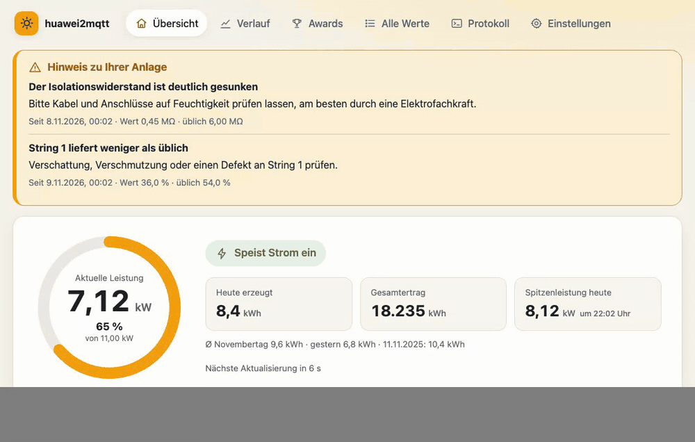
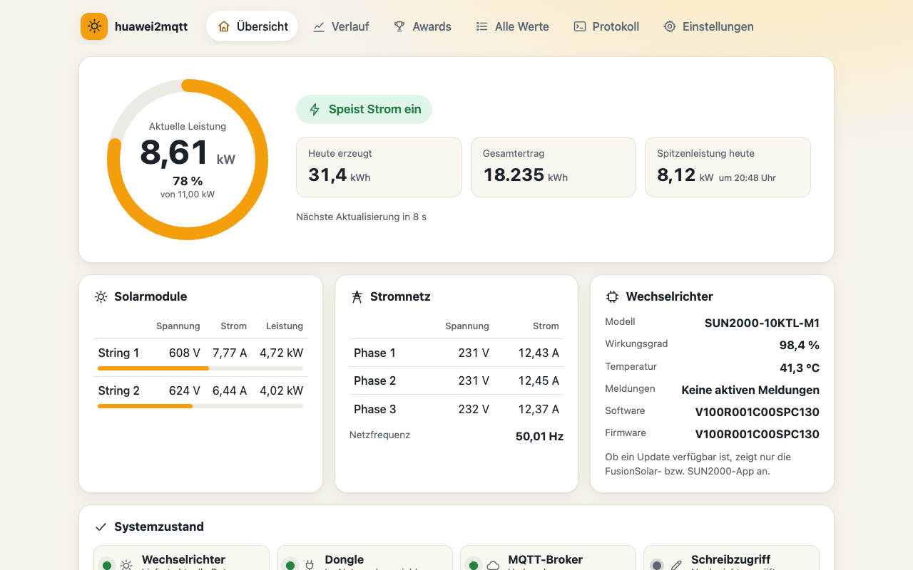
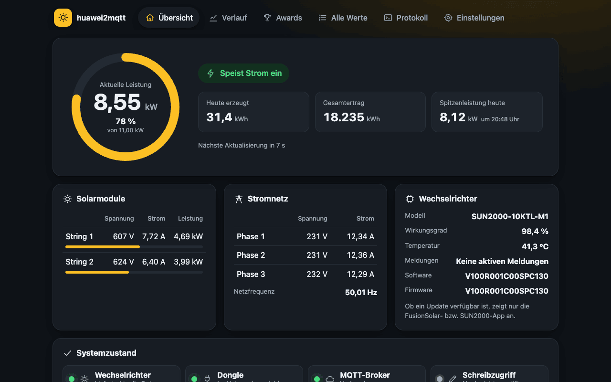
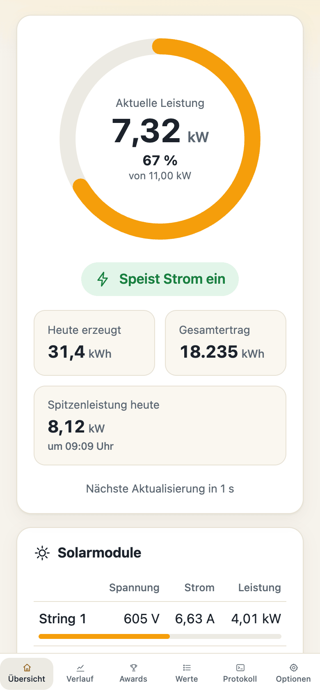
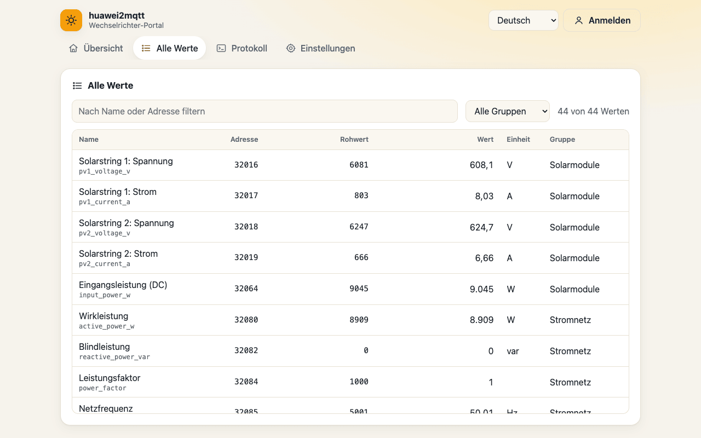
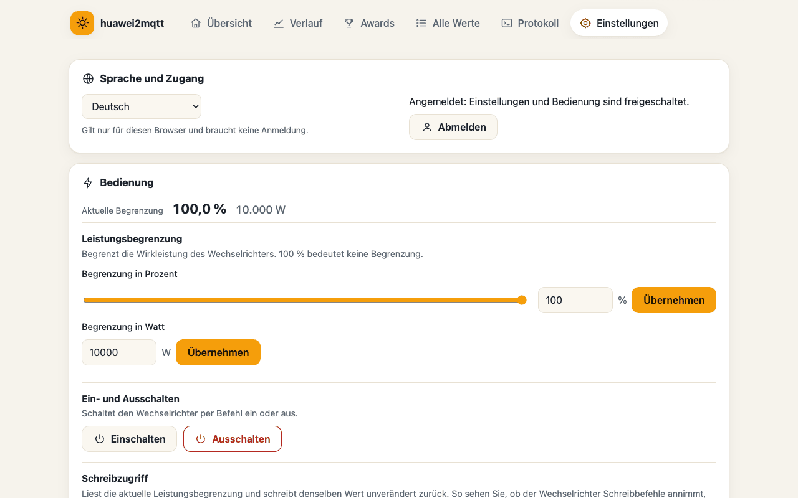
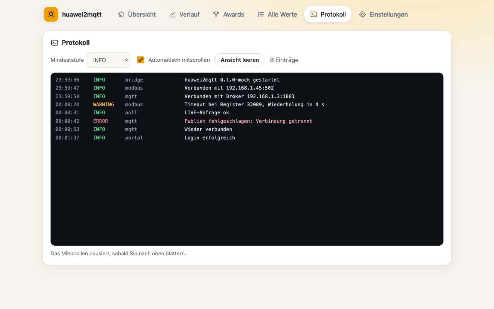
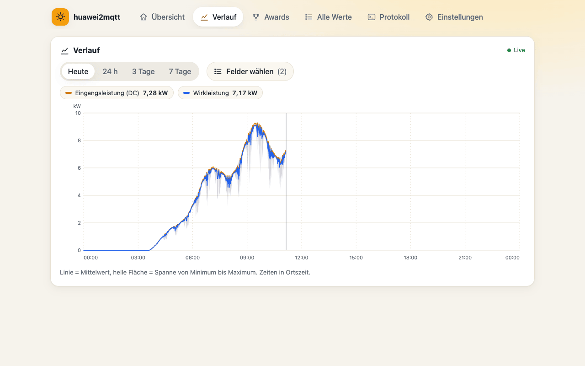
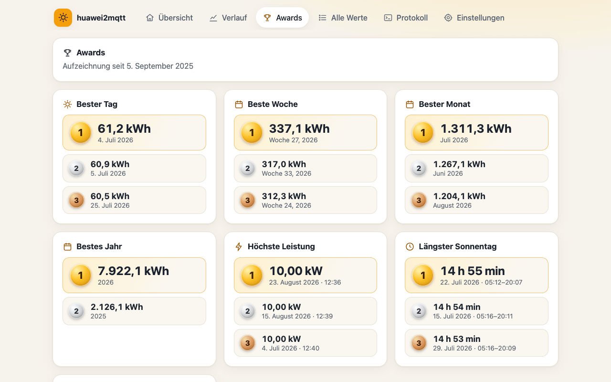
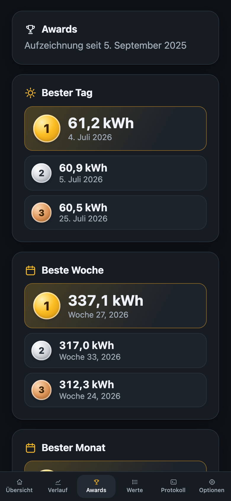

# huawei2mqtt

**Bring your Huawei SUN2000 solar inverter to MQTT — read everything, control the essentials, see it all in a friendly web portal.**

[🇩🇪 Deutsche Version](README.de.md)



huawei2mqtt is a small Docker container that talks to a Huawei SUN2000 inverter via
**Modbus TCP** (usually through the Huawei **SDongle**), publishes all live values to
your **MQTT broker** and accepts a few carefully chosen **commands** (power limit,
on/off). A built-in web portal shows the current state, all register values, the
connection status of every component and the log — in seven languages.

- 📈 **All the data**: PV strings, grid (3 phases), yield, status in plain words, temperature, insulation, alarms, device info
- 🎛️ **Control**: limit active power in % or W, switch the inverter on — and off, if you explicitly allow it
- 📊 **History & awards**: every 10-second value for 7 days (configurable) in a live chart; best day/week/month/year, peak power, milestones, CO₂ saved and yield in money — all stored locally in SQLite, also queryable via MQTT
- 🛡️ **Robust**: survives inverter, dongle or broker outages, reconnects by itself, never hammers the dongle
- 🪶 **Lightweight**: one small Python process, ~4 runtime libraries, ~30 MB RAM, non-root
- 🍓 **Runs on a Raspberry Pi**: images for amd64 and arm64 (Raspberry Pi 3/4/5 with 64-bit OS)
- 🌍 **Portal in 7 languages**: English, Deutsch, Nederlands, Français, Italiano, Español, Polski
- ⚙️ **Configured by one `.env` file**

> Tested with a **SUN2000-10KTL-M1** behind an **SDongleA**. Other SUN2000 models
> (KTL-M0/M1/M2, MAP0, L1 …) share the same Modbus register map and should work for
> the values covered here. Battery (LUNA2000) and power meter (DTSU666) are not yet
> covered — contributions welcome, see [Extending](#extending).

---

## Contents
- [Screenshots](#screenshots)
- [Requirements](#requirements)
- [Quick start](#quick-start)
- [Configuration](#configuration)
- [MQTT topics](#mqtt-topics)
- [Commands](#commands)
- [Web portal](#web-portal)
- [Running behind a reverse proxy](#running-behind-a-reverse-proxy)
- [Troubleshooting](#troubleshooting)
- [Extending](#extending)
- [Development](#development)
- [Credits & license](#credits--license)

## Screenshots

| Overview (light) | Overview (dark) | Mobile |
|---|---|---|
|  |  |  |

| All values | Settings & control | Log |
|---|---|---|
|  |  |  |

| History | Awards | Awards (mobile, dark) |
|---|---|---|
|  |  |  |

## Requirements

1. **Modbus TCP must be enabled on the SDongle.** In the FusionSolar app:
   *Device commissioning* → log in as **installer** → *Settings* → *Communication
   configuration* → *Dongle parameter settings* → **Modbus TCP** →
   **Enable (unrestricted)**. "Restricted" only allows reading for whitelisted
   clients; writing (commands) needs *unrestricted*. The option is not visible to the
   normal *owner* account — that's why many people can't find it.
2. The SDongle (or the inverter's own WLAN/FE port) must be reachable from the Docker
   host, TCP port **502**.
3. An **external MQTT broker** (e.g. Mosquitto). huawei2mqtt does not ship a broker.
4. Docker with Compose.

> ℹ️ The SDongle reliably serves **one Modbus TCP client at a time**. Do not run
> several Modbus tools against it in parallel. The FusionSolar cloud keeps working
> alongside huawei2mqtt.

## Quick start

```bash
mkdir huawei2mqtt && cd huawei2mqtt
curl -LO https://raw.githubusercontent.com/Rilnaista/huawei2mqtt/main/docker-compose.yml
curl -L  https://raw.githubusercontent.com/Rilnaista/huawei2mqtt/main/.env.example -o .env
# edit .env: at least HUAWEI_HOST and MQTT_HOST (+ credentials, PORTAL_PASSWORD)
docker compose up -d
```

Open `http://<docker-host>:8080`. After a few seconds the values appear, and on the
broker you'll find them under `huawei/<serial-number>/…`:

```bash
mosquitto_sub -h <broker> -u <user> -P <pass> -t 'huawei/#' -v
```

Images: `ghcr.io/rilnaista/huawei2mqtt` (tags `latest`, `x.y.z`, `x.y`) for linux/amd64 and linux/arm64 —
the arm64 image runs on Raspberry Pi 3/4/5 with a 64-bit OS (the default for current Raspberry Pi OS).
32-bit Raspberry Pi OS (armv7) is not supported yet.

## Configuration

Everything is configured in `.env` ([`.env.example`](.env.example) contains all keys
with comments). Only `HUAWEI_HOST` and `MQTT_HOST` are mandatory.

| Key | Default | Meaning |
|---|---|---|
| `HUAWEI_HOST` | – | IP/host of the SDongle (or inverter) **(required)** |
| `HUAWEI_PORT` | `502` | Modbus TCP port |
| `HUAWEI_UNIT_ID` | `1` | Modbus unit id of the inverter (behind an SDongle usually `1`; direct WLAN-FE often `0`) |
| `HUAWEI_DEVICE_ID` | serial number | Name used in the topic instead of the serial number |
| `HUAWEI_ALLOW_SHUTDOWN` | `false` | Allow the `off` command. Off by default for safety |
| `MODBUS_TIMEOUT` | `5` | Request timeout (s) |
| `MODBUS_REQUEST_DELAY_MS` | `200` | Pause between two requests (protects the dongle) |
| `POLL_INTERVAL_LIVE` | `10` | Live values interval (s), minimum 5 |
| `POLL_INTERVAL_STATIC` | `300` | Device data / control values interval (s), minimum 60 |
| `MQTT_HOST` | – | Broker host **(required)** |
| `MQTT_PORT` | `1883` | Broker port |
| `MQTT_USERNAME` / `MQTT_PASSWORD` | – | Broker credentials (optional) |
| `MQTT_CLIENT_ID` | `huawei2mqtt-<id>` | MQTT client id |
| `MQTT_TLS` / `MQTT_TLS_INSECURE` / `MQTT_CA_FILE` | `false` / `false` / – | TLS to the broker |
| `MQTT_KEEPALIVE` | `60` | Keepalive (s) |
| `MQTT_QOS` | `0` | QoS for published values |
| `MQTT_RETAIN` | `true` | Publish values retained |
| `MQTT_BASE_TOPIC` | `huawei` | Topic prefix |
| `MQTT_FLAT_TOPICS` | `true` | Additionally publish one topic per value |
| `PORTAL_PORT` | `8080` | Host port of the portal (compose mapping) |
| `PORTAL_PASSWORD` | – | Password for changes in the portal. Empty = portal is read-only |
| `HISTORY_DAYS` | `7` | How many days of 10-second history to keep (1–90). Daily values/awards are kept forever |
| `FEED_IN_TARIFF` | `0.08` | Feed-in tariff per kWh, used for the "yield in money" award |
| `CURRENCY` | `EUR` | Currency code shown with money values |
| `CO2_FACTOR` | `0.38` | kg CO₂ saved per kWh (default ≈ German grid mix) |
| `MILESTONE_STEP_KWH` | `1000` | Step between total-yield milestones |
| `LOG_LEVEL` | `INFO` | `DEBUG`, `INFO`, `WARNING`, `ERROR` |
| `TZ` | `Europe/Berlin` | Time zone |

Intervals, log level, retain, per-value topics, history days, tariff, currency, CO₂ factor and milestone step can also be changed in the portal
(after login); those changes are stored in the `/data` volume and override `.env`.
Connection settings and secrets can only be changed in `.env` — the portal shows
secrets only as "set / not set".

## MQTT topics

Base topic: `<MQTT_BASE_TOPIC>/<DEVICE_ID>`, by default **`huawei/<serial-number>`**.

Every group is published as one **JSON object** (with a `ts` timestamp in UTC) and —
unless `MQTT_FLAT_TOPICS=false` — every field additionally as its **own topic** with a
plain value, e.g. `huawei/HV2260000000/grid/active_power_w` → `6430`.
Invalid values (e.g. insulation resistance at night) are `null` in the JSON and
not published as single topics. All values are retained by default.

| Topic | Interval | Fields |
|---|---|---|
| `…/availability` | LWT | `online` / `offline` (bridge alive and connected) |
| `…/bridge` | on change | `inverter` (`online`/`stale`/`offline`), `dongle` (`reachable`/`unreachable`), `write_access` (`verified`/`unverified`/`denied`), `last_success`, `version`, `dropouts_24h` (short communication drop-outs in the last 24 h) |
| `…/pv` | live | `pv1_voltage_v`, `pv1_current_a`, `pv1_power_w`, `pv2_voltage_v`, `pv2_current_a`, `pv2_power_w`, `input_power_w` |
| `…/grid` | live | `active_power_w`, `reactive_power_var`, `power_factor`, `frequency_hz`, `voltage_l1_l2_v`, `voltage_l2_l3_v`, `voltage_l3_l1_v`, `voltage_l1_v`, `voltage_l2_v`, `voltage_l3_v`, `current_l1_a`, `current_l2_a`, `current_l3_a` |
| `…/energy` | live | `daily_yield_kwh`, `total_yield_kwh`, `peak_power_today_w`, `peak_power_today_ts` (time of today's peak, `null` if the bridge wasn't running then) |
| `…/inverter` | live | `status` (text key, e.g. `on_grid`, `standby_no_irradiation`), `status_code`, `running`, `efficiency_pct`, `internal_temperature_c`, `insulation_resistance_mohm`, `fault_code`, `alarms` (list of text keys), `alarm_1..3`, `state_1..3` (raw bit fields), `startup_time`, `shutdown_time` |
| `…/device` | static | `model`, `serial_number`, `part_number`, `software_version`, `firmware_version`, `model_id`, `pv_strings`, `mppt_count`, `rated_power_w`, `max_power_w` |
| `…/control` | static + after every command | `power_limit_pct`, `power_limit_w`, `shutdown_allowed` |
| `…/awards` | at start, after midnight, on change (max. every static interval) | rankings (top 3), milestones, CO₂, money — same JSON as `GET /api/awards` |
| `…/control/result` | after every command | `{"command","value","status":"ok\|rejected\|error","reason","ts"}` (not retained) |

**Status semantics:** `inverter = stale` means the last poll failed but values are
younger than 3 × live interval; `offline` means older. While stale/offline, the value
groups are not republished — the retained values stay, and their `ts` tells their age.
At night the inverter reports `standby_no_irradiation` and 0 W — that's normal.

Example payload `huawei/HV2260000000/pv`:
```json
{"pv1_voltage_v": 605.6, "pv1_current_a": 6.97, "pv1_power_w": 4221,
 "pv2_voltage_v": 622.9, "pv2_current_a": 5.77, "pv2_power_w": 3594,
 "input_power_w": 7814, "ts": "2026-06-21T11:02:10Z"}
```

### Querying history via MQTT

Publish a request to `…/history/get` (not retained, max. one request per 2 s); the answer
arrives on `…/history/result` (not retained). Answers always come from the bridge's local
database — never from an extra Modbus request.

```bash
# today's PV and grid power, 300 points (avg/min/max per point)
mosquitto_pub -t 'huawei/HV2260000000/history/get' -m '{"id":"1","type":"samples","fields":["input_power_w","active_power_w"],"points":300}'
# daily values of a period
mosquitto_pub -t 'huawei/HV2260000000/history/get' -m '{"id":"2","type":"daily","from":"2026-07-01","to":"2026-07-31"}'
# awards
mosquitto_pub -t 'huawei/HV2260000000/history/get' -m '{"id":"3","type":"awards"}'
```
`samples` accepts `from`/`to` (ISO time, default: today), up to 10 `fields` and up to 2000 `points`.

## Commands

| Topic | Payload | Effect |
|---|---|---|
| `…/control/power_limit_pct/set` | `0` … `100` (one decimal) | Limit active power to a percentage of max. power (register 40125). `100` = no limit |
| `…/control/power_limit_w/set` | `0` … `max_power_w` (integer) | Limit active power to a fixed value in W (register 40126) |
| `…/control/power/set` | `on` \| `off` | Start up (40200) / shut down (40201). **`off` only with `HUAWEI_ALLOW_SHUTDOWN=true`** |

Every command answers on `…/control/result` and triggers an immediate re-read of
`…/control`. Safety rules:

- **Retained messages on set topics are ignored** — a forgotten retained `off` can never
  switch your inverter off at every restart.
- At most one write per 2 seconds; out-of-range values are rejected.
- Only the commands listed above exist. Grid code, reactive power / cos φ, export
  limitation (needs a meter), time, reset and firmware are **deliberately not** exposed.
- The FusionSolar app/cloud may change the same settings — the last writer wins.

```bash
mosquitto_pub -h <broker> -u <user> -P <pass> -t 'huawei/HV2260000000/control/power_limit_pct/set' -m 50
```

## Web portal

- **Overview** – current power, yield, today's peak with time, status in plain words, strings, grid, firmware, connection status of inverter, dongle and broker, write access, and a countdown to the next update. Short drop-outs and outages are shown clearly.
- **History** – live line chart of any values (today, 24 h, up to the configured number of days), average line plus min/max band.
- **Awards** – top 3 days, weeks, months, years, peak power, longest sunny day, earliest start; milestones, CO₂ saved and yield in money. Without a smart meter the money value is *total yield × feed-in tariff* — self-consumed energy is actually worth more.
- **All values** – every register with address, raw value, scaled value and unit; filterable.
- **Log** – live log with level filter.
- **Settings** – language (no login needed) and login; after login: power limit, on/off, write test, intervals, log level, MQTT options, history/awards options and *clear storage* (history only, daily values + awards, or everything).

Without `PORTAL_PASSWORD` the portal is read-only. Login attempts are rate-limited.
**Forgot the password?** It is `PORTAL_PASSWORD` in your `.env` — change it and run `docker compose up -d`.
The **write test** reads the current power limit and writes the same value back — it
proves that the dongle accepts writes without changing anything.

`GET /healthz` is used by the Docker health check. The portal API is documented in
[docs/ARCHITECTURE.md](docs/ARCHITECTURE.md).

## Running behind a reverse proxy

The portal works fine behind nginx / Nginx Proxy Manager / Traefik with TLS
termination. Session cookies become `Secure` automatically when the proxy sends
`X-Forwarded-Proto: https`. If the container joins the proxy's Docker network you can
drop the `ports:` mapping entirely:

```yaml
services:
  huawei2mqtt:
    image: ghcr.io/rilnaista/huawei2mqtt:latest
    env_file: .env
    volumes: [huawei2mqtt-data:/data]
    networks: [proxy]
    restart: unless-stopped
networks:
  proxy:
    external: true
    name: <your-proxy-network>
volumes:
  huawei2mqtt-data:
```
Proxy target: `http://huawei2mqtt:8080`.

> 🔒 The portal is meant for your home network. If you expose it to the internet, put
> additional authentication in front of it.

## Troubleshooting

| Symptom | Cause / fix |
|---|---|
| Dongle `unreachable` | Wrong `HUAWEI_HOST`/port, dongle offline, or Modbus TCP disabled on the dongle |
| Dongle reachable, inverter `offline` | Wrong `HUAWEI_UNIT_ID` (SDongle: `1`, direct WLAN-FE: often `0`), or another Modbus client is connected |
| All values 0, status "waiting for sun" | It's night 🌙 — normal |
| Commands → `error`, write access `denied` | Modbus TCP on the dongle is set to *restricted*; set it to *Enable (unrestricted)* |
| `rejected: shutdown_not_allowed` | Set `HUAWEI_ALLOW_SHUTDOWN=true` if you really want remote shutdown |
| Broker `disconnected` | Check `MQTT_HOST`, port, credentials, TLS; the bridge retries with back-off (2 s … 60 s) |
| Dongle unreachable for a long time, FusionSolar shows no data either | The SDongle has hung (seen as: joined to Wi-Fi but no IP address). Power-cycle the inverter: AC breaker **off**, then DC switch **off**, wait ≥ 5 min, AC **on**, then DC **on**. The bridge reconnects by itself |
| "x short drop-outs in 24 h" | The dongle didn't answer a request in time; the bridge retried and reconnected. Occasional drop-outs are harmless; many may point to weak Wi-Fi |
| Power limit changes back by itself | FusionSolar app/cloud or the grid operator's scheduling overrides it |

History, daily values and awards live in `/data/huawei2mqtt.db` (SQLite) — keep the `/data` volume when updating.

Set `LOG_LEVEL=DEBUG` for detailed Modbus/MQTT logs (secrets are never logged).

## Extending

The register map is declarative: [`bridge/registers.py`](bridge/registers.py) — one
line per value (address, type, gain, unit, group, field, interval). A new value is
usually **one new line**; blocks are built automatically, the value appears in MQTT,
in `/api/values` and in the portal's *All values* view. Add a label to `web/i18n/*.json`
(`field.<key>`) for a nice name in the portal.

Architecture, module overview and portal API: [docs/ARCHITECTURE.md](docs/ARCHITECTURE.md).

## Development

```bash
python3.12 -m venv .venv && .venv/bin/pip install -r requirements-dev.txt
.venv/bin/pytest -q                       # unit tests (Modbus + MQTT mocked) and portal i18n tests
cp .env.example .env && $EDITOR .env
.venv/bin/python -m bridge                # run locally, portal on :8080
python3 tests/ui/mock_server.py           # portal preview with demo data on :8099 (password: demo)
```

Releases: pushing a tag `vX.Y.Z` builds multi-arch images and publishes them to
ghcr.io (and Docker Hub, if `DOCKERHUB_USERNAME`/`DOCKERHUB_TOKEN` secrets exist).

## Credits & license

MIT — see [LICENSE](LICENSE). Third-party components and their licenses:
[CREDITS-bridge.md](CREDITS-bridge.md), [CREDITS-ui.md](CREDITS-ui.md).

Register definitions follow Huawei's public document *"SUN2000 Modbus Interface
Definitions"*. This project is not affiliated with or endorsed by Huawei.
**Use at your own risk** — writing to your inverter changes its behaviour.
